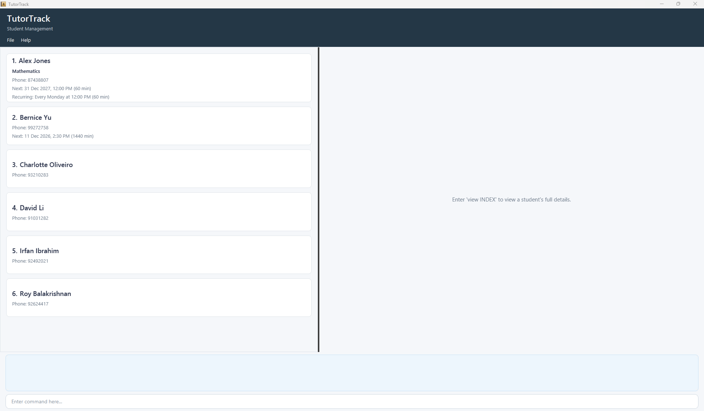
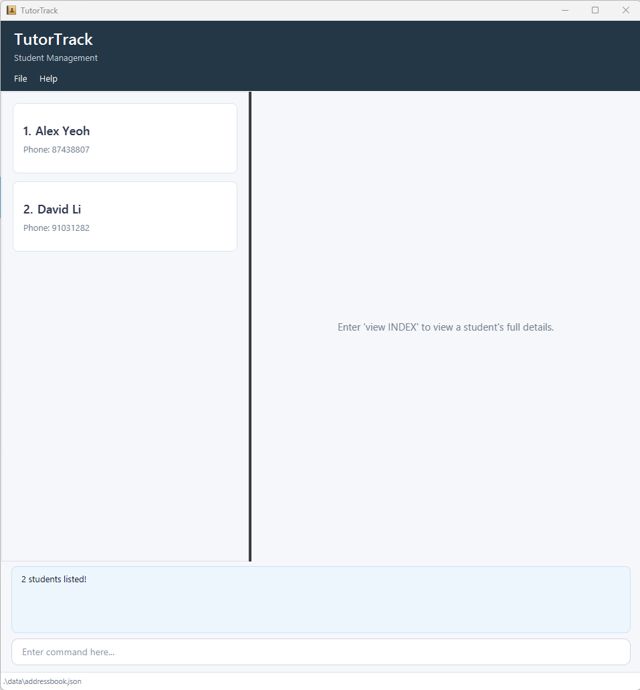

# TutorTrack User Guide

TutorTrack is a desktop contact-management application for private tutors who manage multiple students. It is optimised for users who prefer fast keyboard-driven commands while retaining the benefits of a graphical interface.

<!-- * Table of Contents -->
<page-nav-print />

--------------------------------------------------------------------------------------------------------------------

## Quick start

1. Ensure that Java `25` or later is installed on your computer. 
   **Mac users:** Ensure you have the precise JDK version prescribed [here](https://se-education.org/guides/tutorials/javaInstallationMac.html).

1. Download the latest `.jar` file from [here](https://github.com/AY2627S1-CS2103T-F14a-3/tp/releases).

1. Copy the file to the folder you want to use as the _home folder_ for TutorTrack.

1. Open a terminal, `cd` to the folder containing the JAR file, and run `java -jar addressbook.jar`. 
   A GUI similar to the one below should appear in a few seconds. Note how the app contains some sample data. 
   

1. Type a command in the command box and press Enter to execute it. For example, type **`help`** and press Enter to open the help window. 
   The command box is located at the bottom of the window. Command feedback appears directly above it. 
   Some example commands you can try:

   * `list` : Lists all students.

   * `add n/John Doe p/98765432 e/johnd@example.com a/John street, block 123, #01-01` : Adds a student named `John Doe` to TutorTrack.

   * `delete 3` : Deletes the 3rd student shown in the current list.

   * `clear` : Deletes all students.

   * `exit` : Exits the app.

1. Refer to the [Features](#features) section below for details of each command.

--------------------------------------------------------------------------------------------------------------------

## Features

<box type="info" seamless>

**Notes about the command format:** 

* Words in `UPPER_CASE` are the parameters to be supplied by the user. 
  For example, in `add n/NAME`, replace `NAME` with a value such as `John Doe`.

* Items in square brackets are optional. 
  For example, `n/NAME [t/TAG]` can be used as `n/John Doe t/friend` or as `n/John Doe`.

* Items followed by `...` can appear zero or more times. 
  For example, `[t/TAG]... ` may be omitted, or written as `t/friend` or `t/friend t/family`.

* Parameters can be in any order. 
  For example, if the command specifies `n/NAME p/PHONE_NUMBER`, `p/PHONE_NUMBER n/NAME` is also acceptable.

* Extraneous parameters for commands that take no parameters, such as `help`, `list`, `exit`, and `clear`, are ignored. 
  For example, `help 123` is interpreted as `help`.

* If you are using a PDF version of this document, be careful when copying and pasting commands that span multiple lines as space characters surrounding line-breaks may be omitted when copied over to the application.
</box>

### Viewing help: `help`

Shows a message explaining how to access the help page.

<!-- Replace this screenshot after the Help window uses the TutorTrack User Guide URL. -->

Format: `help`

### Adding a student: `add`

Adds a student to TutorTrack.

Format: `add n/NAME p/PHONE_NUMBER e/EMAIL a/ADDRESS [l/SCHOOL_LEVEL] [s/SUBJECT] [t/TAG]... `

<box type="tip" seamless>

**Tip:** A student can have any number of tags, including zero.
</box>

* The school level and subject are optional. If either is omitted, TutorTrack records it as `Not specified`.

Examples:
* `add n/John Doe p/98765432 e/johnd@example.com a/John street, block 123, #01-01`
* `add n/Betsy Crowe p/1234567 e/betsycrowe@example.com a/Newgate Prison l/Secondary 4 s/Mathematics t/friend t/criminal`

### Listing all students: `list`

Shows a list of all students in TutorTrack.

Format: `list`

Each student card groups information into the following sections:

* **Academic Information** — the student's school level and subject
* **Contact Details** — the student's phone number, email address, and home address
* **Tutoring Information** — the student's next lesson and note

Student tags are displayed below the student's name. If a student does not have a scheduled lesson, the card displays `Next lesson: Not scheduled`. Empty notes and optional lesson topics are not displayed.

### Viewing the earliest upcoming lesson: `upcoming`

Shows the student with the earliest upcoming next lesson.

Format: `upcoming`

* Only scheduled next lessons that have not yet started are considered, across all students.
* If several students share the earliest lesson time, all of them are shown.
* If no upcoming lesson is scheduled, an error message is shown. Use `list` to show all students again.

### Sorting students by next lesson: `sort`

Sorts all students by their next scheduled lesson, earliest first.

Format: `sort`

* Students without a scheduled next lesson are placed after all scheduled students, keeping their existing order.
* The new order is saved and all students are shown after sorting.

### Editing a student: `edit`

Edits an existing student in TutorTrack.

Format: `edit INDEX [n/NAME] [p/PHONE] [e/EMAIL] [a/ADDRESS] [l/SCHOOL_LEVEL] [s/SUBJECT] [t/TAG]... `

* Edits the student at the specified `INDEX`. The index refers to the index number shown in the displayed student list. The index **must be a positive integer** 1, 2, 3, ...
* At least one of the optional fields must be provided.
* Existing values will be updated to the input values.
* When editing tags, all of the student's existing tags are removed; adding tags is not cumulative.
* To remove all of a student's tags, enter `t/` without a tag after it.

Examples:
*  `edit 1 p/91234567 e/johndoe@example.com` Edits the phone number and email address of the 1st student to be `91234567` and `johndoe@example.com` respectively.
*  `edit 2 n/Betsy Crower t/` Edits the name of the 2nd student to be `Betsy Crower` and clears all existing tags.
*  `edit 1 l/Junior College 1` Updates the school level of the 1st student.
*  `edit 1 s/Physics` Updates the subject of the 1st student.

### Locating students by name: `find`

Finds students whose names contain any of the given keywords.

Format: `find KEYWORD [MORE_KEYWORDS]`

* The search is case-insensitive; for example, `hans` matches `Hans`.
* Keyword order does not matter; for example, `Hans Bo` matches `Bo Hans`.
* The search considers only names.
* Only full words match; for example, `Han` does not match `Hans`.
* Students matching at least one keyword are returned (an `OR` search); for example, `Hans Bo` returns `Hans Gruber` and `Bo Yang`.

Examples:
* `find John` returns `john` and `John Doe`
* `find alex david` returns `Alex Yeoh`, `David Li` 
  

### Filtering students by academic information or tags: `filter`

Filters students by school level, subject, and/or tags.

Format: `filter [l/SCHOOL_LEVEL] [s/SUBJECT] [t/TAG]...`

* At least one criterion must be supplied.
* A student must match **every** supplied criterion to be shown.
* School level and subject matching are case-sensitive. All specified tags must be present on the student.
* The displayed list changes to show only matching students. Use `list` to show all students again.

Examples:
* `filter l/Secondary 4` shows students in Secondary 4.
* `filter s/Mathematics t/weekday` shows students studying Mathematics who have the `weekday` tag.
* `filter t/weekday t/exam` shows students with both the `weekday` and `exam` tags.

### Adding or replacing a student note: `note`

Adds or replaces the free-form note on a student's record. The index refers to the current displayed student list, including search results.

Format: `note INDEX note/NOTE`

* The note may contain spaces and is saved with the student record.
* Each student has one note. Recording another note replaces the previous text.
* The `note/` prefix is required and must appear exactly once. Repeating it produces an error; ` note/` cannot be included literally inside the note text.
* Leading and trailing spaces are removed; spaces within the note are preserved.
* Non-empty notes are displayed on the corresponding student card.
* To clear a note, use `note INDEX note/` with no text after `note/`.

Example: `note 1 note/Needs extra time for algebra` records a note for the first displayed student.

### Scheduling a student's next lesson: `nextlesson`

Sets or replaces the next lesson for a student. The index refers to the current displayed student list, including search results.

Format: `nextlesson INDEX date/YYYY-MM-DD time/HH:mm dur/MINUTES topic/TOPIC`

* The date must be a valid date in `YYYY-MM-DD` format and the time a valid 24-hour time in `HH:mm` format.
* The lesson must not be in the past, and the topic must not be blank.
* The duration is required and must be a whole number from 1 to 1440 minutes. Times use the computer's local date and time. A 90-minute lesson starting at 23:30 ends at 01:00 the following day.
* A next lesson cannot overlap another student's next lesson or a recurring lesson occurrence, including students hidden by `find` or `filter`. Back-to-back lessons are allowed: 14:00–15:00 and 15:00–16:00 do not clash.
* If a clash is detected, TutorTrack identifies the conflicting student and their lesson's date, start time, and duration. The command leaves all student records and the displayed list unchanged.
* Replacing a student's next lesson ignores that student's old next lesson. The student's own recurring lesson is still checked: an exact weekday and start-time match is allowed as the same occurrence, even if the topic or duration differs; other overlapping times are rejected.
* The lesson is saved with the student and displayed on the student card. Updating it preserves the student's other details, including notes and tags.

Example: `nextlesson 1 date/2030-06-15 time/14:30 dur/90 topic/Algebra` schedules a 90-minute algebra lesson for the first displayed student.

For example, if another student has a 90-minute next lesson on `2030-06-15` at `14:00`, scheduling at `15:00` on that date is rejected. Scheduling at `15:30` is allowed, provided it does not overlap any other student's next lesson. These examples assume the dates are still in the future when entered.

### Clearing a student's next lesson: `clearlesson`

Clears the scheduled next lesson for a student. The index refers to the current displayed student list, including search results.

Format: `clearlesson INDEX`

* The index must be a positive integer identifying a student in the displayed list.
* If the student has no scheduled lesson, TutorTrack reports that no lesson is scheduled.
* Clearing a lesson preserves the student's other details, including academic information, notes, and tags.

Example: `clearlesson 1` clears the next lesson for the first displayed student.

### Setting a student's recurring lesson: `recurringlesson`

Sets or replaces the recurring weekly lesson for a student. The index refers to the current displayed student list, including search results.

Format: `recurringlesson INDEX day/DAY time/HH:mm dur/MINUTES topic/TOPIC`

* The index must be a positive integer identifying a student in the displayed list.
* The day must be a valid day of the week, such as `MONDAY`. Day names are not case-sensitive.
* The duration is required and must be a whole number from 1 to 1440 minutes.
* The time must be a valid 24-hour time in `HH:mm` format, and the topic must not be blank.
* Each student can have one recurring lesson. Setting another recurring lesson replaces the existing one.
* TutorTrack checks the proposed schedule against all students' next lessons and other students' recurring schedules, even when those students are hidden by a filter. Replacing a recurring lesson ignores that student's old recurring schedule.
* An exact weekday and start-time match with the same student's next lesson is allowed as the same occurrence, even if the topic or duration differs. Other partial overlaps with that student's next lesson are rejected.
* Clashes are checked using actual durations, including lessons crossing midnight or Sunday into Monday. Adjacent lessons are allowed. Weekly schedules have no start or end date and apply every week in local time.
* On conflict, TutorTrack identifies the conflicting student and either their next lesson's date or their recurring lesson's weekday, along with its start time and duration. The command leaves student data and the displayed list unchanged.
* The recurring lesson is saved with the student and displayed on the student card.
* Updating the recurring lesson preserves the student's other details, including the next lesson, notes, and tags.

Example: `recurringlesson 1 day/MONDAY time/16:30 dur/90 topic/Algebra` schedules a 90-minute Algebra lesson every Monday at 4:30 PM for the first displayed student.

### Clearing a student's recurring lesson: `clearrecurringlesson`

Clears the recurring weekly lesson for a student. The index refers to the current displayed student list, including search results.

Format: `clearrecurringlesson INDEX`

* The index must be a positive integer identifying a student in the displayed list.
* If the student has no recurring lesson, TutorTrack reports that no recurring lesson is scheduled.
* Clearing a recurring lesson preserves the student's other details, including the next lesson, academic information, notes, and tags.

Example: `clearrecurringlesson 1` clears the recurring lesson for the first displayed student.

### Deleting a student: `delete`

Deletes the specified student from TutorTrack.

Format: `delete INDEX`

* Deletes the student at the specified `INDEX`.
* The index refers to the index number shown in the displayed student list.
* The index **must be a positive integer** 1, 2, 3, ...

Examples:
* `list` followed by `delete 2` deletes the 2nd student in TutorTrack.
* `find Betsy` followed by `delete 1` deletes the 1st student in the results of the `find` command.

### Clearing all students: `clear`

Clears all students in TutorTrack.

Format: `clear`

### Exiting the program: `exit`

Exits the program.

Format: `exit`

### Saving the data

TutorTrack automatically saves data after every command. You do not need to save manually.

### Editing the data file

TutorTrack data is saved automatically as a JSON file `data/addressbook.json`, located inside the folder you launch TutorTrack from (its current working directory). `preferences.json` and the log file are created there too. To keep using the same data, always start TutorTrack from the same folder. Advanced users are welcome to update data directly by editing that data file.

<box type="warning" seamless>

**Caution:**
If your changes make the data file invalid, TutorTrack starts with an empty student list at the next run. The invalid file remains on disk until you run a command (TutorTrack saves after every command). Still, we recommend backing up the file before editing it. 
Furthermore, certain edits can cause TutorTrack to behave in unexpected ways (e.g., if a value entered is outside of the acceptable range). Therefore, edit the data file only if you are confident that you can update it correctly.
</box>

--------------------------------------------------------------------------------------------------------------------

## FAQ

**Q**: How do I transfer my data to another computer? 
**A**: Install the app on the other computer and overwrite the data file it creates with the data file from your previous TutorTrack home folder.

--------------------------------------------------------------------------------------------------------------------

## Known issues

1. **When using multiple screens**, if you move the application to a secondary screen, and later switch to using only the primary screen, the GUI will open off-screen. The remedy is to delete the `preferences.json` file created by the application before running the application again.
2. **If you minimize the Help Window** and then run the `help` command (or use the `Help` menu, or the keyboard shortcut `F1`) again, the original Help Window will remain minimized, and no new Help Window will appear. The remedy is to manually restore the minimized Help Window.

--------------------------------------------------------------------------------------------------------------------

## Command summary

Action     | Format and Examples
-----------|----------------------------------------------------------------------------------------------------------------------------------------------------------------------
**Add**    | `add n/NAME p/PHONE_NUMBER e/EMAIL a/ADDRESS [t/TAG]... `   e.g., `add n/James Ho p/22224444 e/jamesho@example.com a/123, Clementi Rd, 1234665 t/friend t/colleague`
**Clear**  | `clear`
**Delete** | `delete INDEX`  e.g., `delete 3`
**Edit**   | `edit INDEX [n/NAME] [p/PHONE_NUMBER] [e/EMAIL] [a/ADDRESS] [t/TAG]... `  e.g., `edit 2 n/James Lee e/jameslee@example.com`
**Find**   | `find KEYWORD [MORE_KEYWORDS]`  e.g., `find James Jake`
**Filter** | `filter [l/SCHOOL_LEVEL] [s/SUBJECT] [t/TAG]...`  e.g., `filter l/Secondary 4 s/Mathematics t/weekday`
**List**   | `list`
**Upcoming** | `upcoming`
**Sort**   | `sort`
**Next lesson** | `nextlesson INDEX date/YYYY-MM-DD time/HH:mm dur/MINUTES topic/TOPIC`  e.g., `nextlesson 1 date/2030-06-15 time/14:30 dur/90 topic/Algebra`
**Clear next lesson** | `clearlesson INDEX`  e.g., `clearlesson 1`
**Recurring lesson** | `recurringlesson INDEX day/DAY time/HH:mm dur/MINUTES topic/TOPIC`  e.g., `recurringlesson 1 day/MONDAY time/16:30 dur/90 topic/Algebra`
**Clear recurring lesson** | `clearrecurringlesson INDEX`  e.g., `clearrecurringlesson 1`
**Note**   | `note INDEX note/NOTE`  e.g., `note 1 note/Needs extra time for algebra`
**Help**   | `help`
**Exit**   | `exit`
**Clear recurring lesson** | `clearrecurringlesson INDEX`  e.g., `clearrecurringlesson 1`
**Note** | `note INDEX note/NOTE`  e.g., `note 1 note/Needs extra time for algebra`
**Help** | `help`
**Exit** | `exit`
